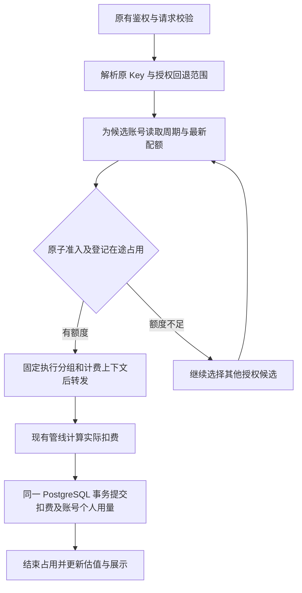

# 用户对共享账号动态周期额度：技术设计

## 文档状态

本设计对应已确认的[需求提案](proposal.md)和[验收规格](specs/user-account-dynamic-quota/spec.md)，包含已确认的 D01～D03。技术设计和[实现计划](tasks.md)已确认，本地实现包含管理页面、原子准入/结算及 Fork 更新器；分层验收结果见[验收记录](verification.md)。已生成本地模拟制品，未创建正式 GitHub Release 或执行线上操作。

本地源码基线为 `b0a02a3304a0a78cdd003ddda1dd23ba02c03084`。下述为已确认设计，实际实现入口和验证层级以验收记录为准，不把文档描述当作生产证据。

## Context

当前预计总费用由前端的 `openAISevenDayEstimatedTotalCost` 计算，使用账号周期统计费用与上游利用率；个人实际扣费由现有计费管线确定。当前调度按 Key 所属分组工作，调度请求中没有独立的用户账号配额上下文。直接复用用户平台额度会混淆累计对象，直接停用账号会影响其他用户。

已有实际扣费先经统一计费仓储提交，再以尽力写入方式记录用量日志。因此，新增额度执行不能把每次实时查询 `usage_logs` 的结果当作可靠的唯一计费依据，也不能只在异步统计页面增加拦截。

当前官方更新器固定读取 `Wei-Shaw/sub2api`，下载后替换当前程序。只 Fork 代码不会改变更新源；直接覆盖官方二进制将失去新增能力。当前版本比较忽略连字符后的修订，定制版本和回滚还需单独处理。

## Goals / Non-Goals

- 在项目现有单体服务内增加账号用户配额能力，沿用 Go、Ent、PostgreSQL、Redis、现有前端和测试体系。
- 对同一用户的全部 Key、既有兼容入口和长连接后续轮次执行同一配额规则。
- 额度更新实时生效，实际扣费、周期归属和重复结算可追踪，重启和升级保持连续。
- 保留管理员页面升级与重启交互，更新到已合并上游并通过验证的 Fork 发布版本。
- 不建立新的外部计费网关，不依赖当前传输插件完成用户配额，不更改现有模型售价算法。
- 不把任意官方二进制、任意旧版本回滚或 Docker 容器内替换文件列为首版支持的升级方式。首版页面升级面向当前非 Docker 二进制部署方式。

## Decisions

### 1. 责任模块与数据流

在现有 `backend/internal/service` 与 `backend/internal/repository` 内增加小范围的账号用户配额服务和仓储。估值、周期、准入、结算分别有明确职责，不让前端、Handler 或更新脚本自行维护第二套额度算法。



主要接入点：

| 现有模块 | 拟承担的调整 |
| --- | --- |
| [account_usage_service.go](../../../backend/internal/service/account_usage_service.go) | 共用后端估值结果，整理采样来源、周期及暂用状态 |
| [openai_account_scheduler.go](../../../backend/internal/service/openai_account_scheduler.go) | 在普通候选、粘性候选、重试和能力过滤中统一排除个人不可用账号 |
| [openai_gateway_handler.go](../../../backend/internal/handler/openai_gateway_handler.go) | 取得账号并发槽位后做最终准入，逐轮管理长连接占用和账号回退 |
| [openai_gateway_usage.go](../../../backend/internal/service/openai_gateway_usage.go) | 把实际扣费及冻结的配额票据交给统一结算 |
| [gateway_usage_billing.go](../../../backend/internal/service/gateway_usage_billing.go) / [usage_billing_repo.go](../../../backend/internal/repository/usage_billing_repo.go) | 沿用现有请求去重，在同一事务内累计配额及完成占用结算 |
| [AccountUsageCell.vue](../../../frontend/src/components/account/AccountUsageCell.vue) | 读取后端同一估值结果，取消该值在前端的独立业务计算 |

接入必须覆盖所有实际能够选择 OpenAI OAuth 账号的现有协议路由；实现计划需先列全路由矩阵，不能仅覆盖 `/v1/responses`。

### 2. 权威数据与精度

- PostgreSQL 保存配置、周期、已结算金额和在途票据，作为准入与结算的权威依据。Redis 可以用于展示缓存、失效通知和已有并发槽位，不承担另一套独立金额余额。
- 首版准入直接读取数据库当前配置与周期，避免成功保存配置后其他实例仍因缓存 TTL 执行旧额度。展示缓存带配置和估值版本，过期展示不影响实际执行。
- 金额沿用 `UsageBillingMonetaryScale` 的 8 位小数和 `QuantizeUsageBillingAmount`；新计数取现有实际扣费的同一量化结果，不重新按 Token 算一次金额。
- 账号统计金额另行记录，复用 `COALESCE(account_stats_cost, total_cost) * account_rate_multiplier` 的语义；不能用其代替用户实际扣费。
- 个人上限按未作展示舍入的预算和份额计算。均分不可整除时按规范精度向下取可用上限，剩余不足一个计量单位的尾数留在账号预算内，不额外分配。

### 3. 持久化模型

已新增五类 Ent schema 和 `246_ablett_account_user_quota.sql`，生成代码通过项目命令维护。该迁移已经在隔离数据库应用验证，后续升级不得改写其 checksum。

| 表 | 关键内容与不变量 |
| --- | --- |
| `account_user_quota_policies` | 每账号一个配置；启用状态、配置版本、有序回退分组、估值暂用规则、审计信息 |
| `account_user_quota_members` | 唯一 `(account_id, user_id)`；参与状态，首版均分；移除只改状态，不能级联删除用量 |
| `account_user_quota_cycles` | 稳定 `cycle_id`、账号、真实窗口起止、采样来源、周期状态、估值及版本、账号累计统计金额 |
| `account_user_quota_usage` | 唯一 `(cycle_id, user_id)`；已结算实际金额、在途占用、回填状态；不能因成员关系删除而丢失 |
| `account_user_quota_reservations` | 请求与尝试标识、原 Key、执行分组、用户、账号、固定周期、占用金额、状态、续期及结算信息 |

用量日志增量增加周期和原始分组的可选关联信息；现有 `group_id` 记录最终执行和计费分组，`api_key_id` 继续指向原 Key。所有新增字段应兼容旧行，不能为了回退修改 Key 在数据库中的绑定分组。

独立去重继续复用现有扣费键和指纹契约；新增配额不能改变旧请求重试时的原指纹。需要额外关联配额票据时，使用既有扣费键的关联信息，不对旧指纹算法做无版本切换。

### 4. 后端统一估值

新增共用估值服务，输入包含账号周期、已确认入账的账号统计金额、最新有效上游利用率及采样时间，输出包含预计总费用、来源周期、是否暂用、失效原因和版本。

继续使用 `E = 账号周期统计费用 × 100 / 已用百分比`。只接纳有限、正数且属于有效窗口的输入，不给小利用率添加未经确认的美元下限、不平滑或改写现有公式。每次有效采样和相关计费提交后重算；配置变更只重算分配关系，不改写账单。

采样按来源和观测时间防止乱序回退，数据库中的金额与预算版本一起返回给页面。估值仍具有上游采样精度和其他渠道使用造成的误差，不把它包装成上游承诺的现金余额。

为了不依赖日志写入是否成功，受控账号从统一计费事务累计账号统计金额，历史周期先从现有统计回填。初始化在同一事务内认领可靠收据并补齐不重复的旧日志水位，管理员核对完整账期后才进入可用状态；缺少可信执行周期的收据进入待核对状态，未核对的新计数器不能直接接替页面值。

### 5. 账号周期识别

`cycle_id` 不直接等于每次返回的 `reset_at`。周期服务沿用 `codex_7d_*` 采样来源和窗口长度，将稳定周期事实与带误差的预计重置时间分开存储。

- 有可信上游窗口且仍处于当前周期时，更新采样不创建新周期。秒级漂移和乱序返回只修正观测信息。
- 到达真实窗口边界或发生已证实的上游提前重置后，在数据库内唯一创建新周期；重复事件不能创建多份预算。
- 不能只凭利用率下降就认定重置；过期采样、不同额度维度和时间漂移都可能产生类似表现。
- 边界未确认时进入同步中状态，利用已有上游查询能力确认；不能按服务器自然周强行推进。
- 一个请求在最终准入时固定 `cycle_id`。稍后发生真实重置，结算仍写该票据的旧周期，用户真实扣费正常执行。
- 全部时间内部按绝对时间处理，时区仅用于显示。多个实例以同一数据库和上游窗口事实判断，不能分别创建本地周期。

同一真实额度是否存在重复账号或影子账号，接入前需核对。首版策略键不自动合并不同账号记录；如果它们共享同一实际 7 天配额，必须在实施前确定统一的额度所有者，不能通过另一记录绕过限制。

### 6. D01：暂用与初始化

有效状态为 `current`、`carryover`、`initializing`、`unavailable`。暂用最近有效估值时同时保存原周期和原时间，绝不能因为读了一次旧值就刷新其有效期。

暂用期限定在当前已确认周期内，并有独立的可配置最长等待时间；期限从真实窗口切换或本轮数据缺失时起算，不跨多个周期无限续用。实现计划依据现有 10 分钟主动采样节流，使用已确认的 30 分钟暂用期限作为初始配置；到期无法得到有效数据时停止向该账号准入并尝试授权回退，界面明确显示估值不可用。

没有历史有效值时，不随机填预算。提供管理员受控初始化操作：优先用现有周期的可核对账单及上游进度建立基准；仍无样本时，可选择有权限的计费用户和执行分组，发起有单次输出、总费用及次数边界的校准请求。样本通过真实计费管线累计，并等待有效利用率后形成估值。

初始化模式只能由受保护的管理操作创建，不能由普通请求头或客户端参数开启；它不是普通请求的无限额例外。达到采样边界仍不能形成估值时保留待初始化状态，结束本轮操作，禁止无限循环。

现有 `probeOpenAICodexSnapshot` 主要提取响应头，不生成完整的个人实际扣费事实。因此，不能仅调用该方法就宣称完成费用基数初始化；校准需复用完整用量解析和扣费过程，且不能与另一处探针金额重复累计。

### 7. D02：准入、在途占用与事务结算

筛选候选时可批量读取可用状态，但最终准入必须在取得账号执行槽位后完成。准入事务按固定顺序读取有效配置和周期、锁定用户周期用量，再原子判断 `Q - 已结算 - 已占用` 并登记票据，避免并发都通过旧余额。

占用金额复用现有定价解析、输入估计和输出预算规则，不自建第二份模型价目表。已开始请求允许正常结束，最终实际金额可以产生已确认的结算尾差；不能把预留估计称为严格费用上界。无法产生可靠估计的计费类型不得直接按零占用放行，应返回可定位的不可用状态并尝试其他授权账号。

票据状态为 `reserved`、`sent`、`settled`、`released`、`uncertain`。发起上游之前固定执行分组、定价上下文和周期；准入登记 `reserved`，在实际 HTTP 发送或 WebSocket 写入前才标记 `sent`；未发送失败释放，发送后结果不明保留占用。后续配置变化不追杀已开始请求，但下一轮必须重新判断。

结算扩展现有 `UsageBillingCommand` / `usageBillingRepository.Apply`，在其同一个 `sql.Tx` 内执行：

1. 沿用原扣费键判断是否已经应用。
2. 执行原余额或有效订阅扣费、Key 用量等既有效果。
3. 按票据固定周期累加同一笔量化后的 `actual_cost`，更新账号统计金额。
4. 幂等完成对应占用结算，提交后再更新展示缓存和非关键通知。

配额仓储不能另外开连接提交一份“看似同事务”的计数。受控账号没有统一结算仓储时不得走会遗漏配额的旧降级路径；重复计费回调不能再次增加用量或重复释放。

未发送上游的失败可安全释放；已发送的失败或客户端断开继续收集已有用量并按现有部分计费语义结算。占用直到扣费事务完成后才释放，不以 Handler 返回作为结算完成信号。长请求续期，停机需排空请求和计费任务；无法判断是否已消费的遗留票据标为 `uncertain` 并核对，不能只因 TTL 到期就宣称免费且释放全部风险。

实时降额、成员移除和新周期产生不改写已发生账单。已用可能高于新上限，账面剩余显示零；记录差额，后续请求换账号或拒绝。

### 8. D03：授权跨分组回退与计费归属

在账号策略中配置有序回退分组，并按用户明确授权范围收窄；默认不枚举用户所有 Key，也不把所有公开分组自动加入回退。每次回退重新验证当前用户与目标分组资格，包括标准分组的 `CanBindGroup` 或订阅分组的有效订阅。

建立不可变的请求执行上下文，保留原用户、原 Key、原始分组、有效执行分组、有效订阅、定价时刻、账号和配额票据。所有下游定价与日志读取这一上下文，不能在若干 Handler 中临时改 `apiKey.GroupID` 后遗漏恢复。

- 原 Key 的总额、窗口限额、用户级限制及认证继续生效。
- 目标分组的模型允许范围、隐私要求、能力、倍率和订阅条件重新校验；原请求已经施加的权限限制不能因目标分组更宽而被放大。
- 最终价格使用目标分组及该用户在目标分组的有效倍率；订阅场景关联目标分组的有效订阅。原 Key 身份仍用于审计、去重和 Key 用量累计。
- 一个分组及账号在同次回退中有明确访问记录，禁止形成环或无限重试。耗尽原因与模型、上游限流、估值不可用分开记录。
- 粘性缓存对个人额度没有豁免；清理或更新相应绑定时不能全局停用账号。
- `previous_response_id`、工具续链或其他服务端状态只有可完整重建时才允许换账号。无法迁移时返回明确错误并保留上下文，不继续透支原账号，也不静默丢弃历史。

### 9. 管理接口、展示与错误

复用账号管理鉴权和审计，拟增加账号用户配额读取、原子保存和初始化操作。保存携带期望配置版本，冲突返回可定位错误；禁止重复成员、失效用户、非法占比及越权目标组。首版仅提供均分，不新增不等权重编辑。

管理界面复用现有账号详情或编辑入口，显示参与用户、预计预算与更新时间、暂用状态、真实周期、每人额度、实际已用、在途占用和可用金额。用户侧首版复用错误提示，不新增独立额度大屏。

建议增加稳定的错误原因：`ACCOUNT_USER_QUOTA_EXHAUSTED`、`ACCOUNT_USER_QUOTA_INITIALIZATION_REQUIRED`、`ACCOUNT_USER_QUOTA_ESTIMATE_UNAVAILABLE`、`ACCOUNT_USER_QUOTA_INFLIGHT`、`ACCOUNT_USER_QUOTA_SESSION_PINNED`。精确 HTTP 状态和各协议封装见实现计划；额度耗尽采用限额语义，估值或结算依赖异常采用服务不可用语义，不能混为账号永久失效。

日志记录请求关联、用户与账号标识、原始及最终分组、周期、配置与估值版本、占用/实际金额及切换原因。沿用项目敏感信息保护规则，不记录凭据和完整请求正文。

### 10. 页面更新：统一使用 Fork 发布源

保留现有管理员页面“检查更新 → 安装 → 立即重启”的操作。新程序的更新源为 `ablettx/sub2api` 发布的验证版本，而上游代码来源仍为 `Wei-Shaw/sub2api`；两个概念在版本信息中分别显示。

引入统一的更新源配置或构建元数据，由依赖注入传给 `UpdateService`，对外返回更新仓库、发布渠道和制品信息。不能只改一个字符串而保留其他入口：

| 路径 | 统一要求 |
| --- | --- |
| 检查最新版、安装更新 | 同一 Fork 仓库和稳定渠道；没有合格 Fork 发布时明确报告无可用更新，不退回官方源 |
| 近期版本和指定版本回滚 | 同一 Fork 来源，只列经过兼容校验且包含本功能的版本 |
| 更新缓存及前端状态 | 缓存键包含来源和渠道；不能复用官方检查结果，前端切换版本后清理旧来源状态 |
| 页面版本链接与恢复指令 | 从服务端统一元数据生成；修正当前前端固定的官方仓库、镜像和安装脚本指引，并让安装脚本自身使用相同受控来源 |
| 发布包 | 必须包含当前服务器架构的可执行文件、嵌入前端、校验和及兼容元数据，不能把源码压缩包当安装包 |

下载前验证来源、目标平台、版本和兼容信息，校验和必须存在且匹配，再沿用当前同文件系统的原子替换流程。安装失败保留当前可用程序并报告原因。

原基线 [deploy/install.sh](../../../deploy/install.sh) 固定使用官方 `GITHUB_REPO`。实现已统一脚本内部来源、目标版本、校验和及兼容信息；页面恢复指引与更新器使用同一 Fork 渠道。

### 11. 定制版本号和兼容元数据

建议版本展示保留上游基线和定制修订，例如 `0.2.17-ablett.1`、`0.2.17-ablett.2`。只在受控 Fork 渠道中比较“上游语义版本 + 定制修订序号”，同基线的修订也必须触发更新；不要继续使用当前会忽略后缀的 `parseVersion` 结果。

GitHub 的稳定发布标志、`releases/latest` 接口及现有构建配置中的 `prerelease` 行为需一致：经过完整验证的定制稳定包明确标记为稳定发布；测试包标记预发布且不进入默认页面更新。不能因为标签带后缀就让全部定制稳定包不可发现。

扩展现有发布工具的目标 manifest，补充发布来源、上游基线、定制修订、源码提交、目标平台、校验和、功能能力版本、支持的数据库版本范围及允许回滚下界。更新器拒绝缺少动态配额能力或与当前数据不兼容的包。

现有插件还有独立的版本范围和已测试版本判断。定制标签必须补相容性验证，不能为了比较定制修订而全局改变插件版本语义，或假装未测试版本已经测试过。

### 12. 上游同步、制品发布与日常升级

日常维护链路：

```text
原作者发布版本
  → 在维护分支合并上游，保留配额与受控更新能力
  → 完成业务、迁移、升级与回滚验证
  → 使用确定的同一个源码提交构建前后端及各架构包
  → 在 Fork 发布验证版本
  → 页面检查到新版本
  → 管理员点击安装并确认重启
  → 验证配置、用量及实际请求
```

上游有新发布不意味着定制发布自动合格。同步可自动检测，但出现冲突、功能丢失或迁移失败时停止发布；不能让 Actions 直接覆盖生产服务。提交、推送、发布以及生产更新各自按任务授权执行。

复用 [.github/workflows/release.yml](../../../.github/workflows/release.yml) 与 [.github/release-tools/release_matrix.py](../../../.github/release-tools/release_matrix.py)，在既有同一提交和跨架构校验上增加本功能回归与发布来源校验，不另建平行发布工具链。非 Docker 目标不能采用不包含二进制包的 simple release 作为可更新发布。

Fork 的 Actions 启用、发布权限及制品可访问性需要在首次发布前实测；本设计不假设 Fork 后这些外部状态已经自动配置完成，也不在本阶段操作 GitHub 设置。

### 13. 首次切换和回滚边界

当前官方程序仍指向官方更新源，因此第一次从官方程序切换到定制程序需要一次受控部署，不能依靠原按钮自动识别新的 Fork。首次准备数据库备份、程序回退副本、目标版本和配置校验，部署后核对页面版本来源；此后再使用定制程序中的页面更新入口。

安装与重启继续分开，由页面提示完成；停止接收新请求后排空在途调用与计费任务，未结算票据持久化。启动自动运行兼容迁移，完成后再开放受控账号准入。

回滚必须同时满足“仍含配额能力、可读取当前数据结构、能继续处理票据”。当前 `.backup` 可能是初次切换前的官方程序，不能只因文件存在就允许页面回滚。页面本地备份回滚、指定版本回滚和手动恢复说明必须遵守相同限制。

数据库迁移按现有 forward-only 方式维护。不能承诺替换旧二进制会回滚数据库；不兼容降级需要独立恢复方案和数据核对，不在页面自动执行破坏性降级。

### 14. 数据迁移、回填与配置变更

使用新增的 `NNN_ablett_*.sql` 描述性文件名保留 Fork 归属，编号在实施时依据最新基线确定；已应用文件不修改、不重排，不为合并上游而改 checksum。上游同编号不同文件和后续架构调整通过真实迁移回放验证，而不是靠编号看起来不同来保证安全。

周期中途启用先进入准备状态，按账号真实窗口分批回填历史实际扣费和账号统计金额。回填期间使用明确的账单水位与同一去重依据衔接新结算，核对后再启用，不能通过重跑回填重复累计。

历史日志使用响应记录时间，旧行没有本功能的固定 `cycle_id`，跨周期请求未必能够精确复原；这部分明确标为证据不足并要求核对，不能声称根据一个时间过滤即可完全还原。账单清理策略也需保留本功能仍依赖的周期汇总和去重事实。

成员增减、停用、重新启用只改策略状态和版本，用量随用户及周期保存。启用策略后的非参与用户不能隐式无限使用：需进入配额成员集合才可消耗受控账号；原有访问权限仍是前提。授权回退可继续尝试其他合格账号。

### 15. 失败处理与运行约束

- 配额存储或结算依赖不可用时，对受控账号停止新准入并给出原因；不影响未受控账号原有行为，不把缓存错误解释为无限额。
- 不在每次用户请求中强制向上游探测。复用已有采样并节流，初始化和异常恢复采用明确的受控流程，避免额外请求放大。
- 对同一账号及用户的金额操作采用固定加锁顺序和有限重试，避免多分组回退形成反向锁顺序；小规模共享账号首版直接数据库准入，可在测量后优化。
- 对未知是否发生上游消费、日志缺失或回填不足提供明确状态和核对入口，不能静默当零处理。
- simple 模式不保证真实扣费，首版不允许在该模式开启基于实际扣费的动态配额，管理接口需明确校验。

## Validation Strategy

这里只定义实现后必须完成的验证，不把文档校验当作运行验证。

| 层级 | 必须覆盖的证据 |
| --- | --- |
| 业务与金额 | 预计值涨跌、三人与四人切换、移除再加入、多 Key、不同价格口径、精度尾差、无值初始化与暂用替换 |
| 数据库与并发 | 原子准入、扣费与用量同事务、重复回调、跨周期结算、成员变更竞争、票据不明状态和重启恢复 |
| 路由与权限 | 普通及粘性选择、流式与长连接后续轮次、全部相关协议、原与目标分组约束、目标订阅和价格、不可迁移会话 |
| 页面与兼容 | 管理配置、版本冲突、用量显示、原因区分、既有 Key/平台/订阅额度和未受控账号回归 |
| 升级与发布 | 同基线定制修订发现、来源缓存隔离、完整二进制及前端、校验和、缺能力包拒绝、兼容回滚与原版备份拒绝 |
| 数据延续 | 带现有 $450 用量从前一个维护版升级到新维护版，确认仍为 $450；新请求实际限额继续执行，再核对可用回滚版本 |

优先使用项目现有 `make test-unit`、`make test-integration`、后端 lint，以及前端 `pnpm typecheck`、`pnpm test:run`、`pnpm build`。具体受影响测试集和数据库隔离方式在实现计划中固定；不得拿本地构建成功替代升级后真实请求验证。

## Risks / Trade-offs

1. 原生扩展需要持续维护与上游的调度、计费及更新接口合并；它能在责任模块完整执行规则，代价是必须发布自己的验证版本。
2. 预计费用本身会随上游离散采样和账号外部使用波动。设计保证使用同一有效预算和正确实际扣费，不保证估值等于上游真实可消费金额。
3. 请求级完成策略允许结算尾差，不能同时承诺动态降额后历史用量绝不超过新上限；通过在途占用限制并发放大。
4. 跨组回退必须贯穿鉴权、定价、订阅、去重和日志；仅替换调度的 `group_id` 会造成错误扣费，不能接受这种局部接线。
5. 保留页面更新取决于 Fork 完整制品和兼容元数据已发布，原作者新版本不能跳过合并与验证自动成为生产定制版本。

## 设计评审检查点

- 业务边界、技术设计和实现计划已确认，本地代码与管理界面已实现；后端完整单测、前端完整回归、隔离数据库和受影响 race 检查通过，具体时间与覆盖层级见验收记录。
- 参数边界、金额精度、初始化预算、租期、跨周期结算和兼容更新已有本地证据；真实付费校准、远程发布及生产验证未执行。
- 首版不等份额编辑、其他平台和 Docker 页面内二进制升级不扩入范围。
- 非参与用户需纳入受控账号配额集合，首次上线前核对当前有权用户以避免遗漏。
- 全部需求场景已经映射到实施任务和分层验证证据；此文档不构成提交、推送、发布或生产操作授权。

## 实现计划核验补充

本轮入口核验发现：[openai_live.go](../../../backend/internal/service/openai_live.go) 的 Live 会话目前始终写入零费用日志，没有经过统一实际扣费流程；同时该入口可以选择 OpenAI OAuth 账号。首版已将受控账号排除出该入口的候选并尝试其他合格账号，避免形成未计量消耗通道；其他账号仍按现有行为运行，新增 Live 收费不纳入本需求。已有会话在启用配额前需要核对并结束或等其自然完成，不能伪装为已受金额限制。此兼容边界已确认，隔离数据库与真实调度服务的拒绝和备用账号选择测试通过；已有生产会话尚未核对。

异步单图任务经 [image_task_handler.go](../../../backend/internal/handler/image_task_handler.go) 复用同步 `Images` 执行链，需在后台实际执行时重新校验并准入；不能只在任务创建时检查。Embeddings 现有能力判定仅允许 API Key 账号，需保留排除 OAuth 的反向用例，不扩展其 OAuth 支持。


## 本地实现落点

- 数据与原子结算：`account_user_quota_repo.go` 及 `_billing.go`、`_backfill.go`、`_reconcile.go`；接入原 `UsageBillingRepository.Apply` 的同一事务及去重依据。
- 最终准入与协议：`account_user_quota_execution.go`、`_forward.go`、`_websocket.go`；异步单图复用最新身份核验，WebSocket 按轮重新准入。
- 管理端：`account_user_quota_handler.go`、`AccountUserQuotaPanel.vue`；配置保存、初始化和未决票据核对各有受保护接口。
- 维护更新：`maintenance_release.go`、`update_service.go`、`deploy/install.sh` 及现有 release workflow/helper；页面重启采用 SIGTERM 正常关闭并排空扣费任务。
- 操作步骤与回退边界见[维护指南](../../../docs/maintenance/user-account-quota.md)，实际证据和未覆盖的完整入口组合见[验收记录](verification.md)。
